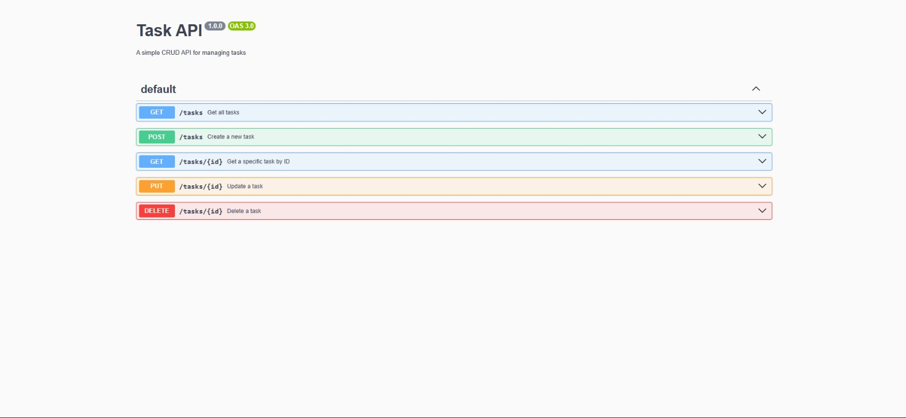

# Secure Auth API

A secure API that handles user authentication (Sign Up, Log In, Log Out) and protects specific routes using Supabase Auth as the Identity Provider. It verifies JSON Web Tokens (JWTs) via middleware to guard protected endpoints.

## Setup & Environment
1. Clone this repository.
2. Run `npm install` to install dependencies (Express, Supabase-js, dotenv, swagger-ui-express).
3. Copy `.env.example` to `.env` and fill in your Supabase credentials:
   ```env
   SUPABASE_URL=your_project_url
   SUPABASE_KEY=your_anon_key
   PORT=3000
## Swagger UI
Interactive API documentation is available at `http://localhost:3000/docs`.

